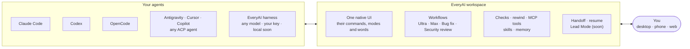

<div align="center">



<br/>

**Every coding agent, one workspace.**<br/>
<sub>Bring Claude Code, Codex, OpenCode, Antigravity and more, or our own agent, or all of them at once. EveryAI adds the workflows, checks and orchestration on top. Your keys, your subscriptions, and local models soon.</sub>

<br/><br/>

<a href="#-get-started"></a>
<a href="https://github.com/xuckless/everyai-mono/actions/workflows/dev-builds.yml"></a>
<a href="https://github.com/xuckless/everyai-mono/actions/workflows/dev-builds.yml"></a>
<br/>
<a href="TERMS-DEV.md"></a>

<br/><br/>

<!-- Screenshot to come: a Code session with several agents. -->


</div>


## ✦ What it does

- **Runs the coding agents you already use** in one native app: Claude Code, Codex, OpenCode, Antigravity, Cursor, Copilot, Qwen, Kiro, Grok and any ACP agent, plus **the EveryAI harness**, our own agent for any model.
- **Makes them better together**: our workflows, checks, rewind and tools work in every agent, and a session can move from one agent to another without losing a step.
- **On your terms**: your own API keys (BYOK), your existing subscriptions, and local models (coming soon). EveryAI spends nothing on sessions it doesn't lead.

## ✦ How it works



## ✦ What you can do

<table>
<tr>
<td width="50%" valign="top">🔌 <b>Bring your agents in</b><br/><sub>EveryAI finds the agents on your computer and sets up the rest in one step. Each keeps its own slash commands, modes and tool names.</sub></td>
<td width="50%" valign="top">⏪ <b>Pick up where you left off</b><br/><sub>Open a folder and resume any earlier session from any agent, with its full history.</sub></td>
</tr>
<tr>
<td valign="top">🔁 <b>Never stop on a limit</b><br/><sub>When a plan's limit runs out, another agent carries on and finishes the cut-off turn. Nothing is redone.</sub></td>
<td valign="top">✨ <b>Superpowers for every agent</b><br/><sub>Ultra, Max, Bug fix and Security review workflows, targeted test checks, checkpoints and rewind, for Claude Code and Codex too.</sub></td>
</tr>
<tr>
<td valign="top">🧭 <b>One team</b> <sup>soon</sup><br/><sub>Lead Mode: EveryAI leads and hands work to the other agents, each in its own worktree.</sub></td>
<td valign="top">📱 <b>Code from anywhere</b><br/><sub>Pair a phone, tablet or browser with your computer (end-to-end encrypted) and drive its sessions live.</sub></td>
</tr>
<tr>
<td valign="top">🔑 <b>Your keys, your models</b><br/><sub>OpenRouter or Anthropic keys stay in your keychain. Local models are coming soon.</sub></td>
<td valign="top">🛡️ <b>Safe by default</b><br/><sub>Per-call approvals, a safety floor for risky commands, and a git worktree per session.</sub></td>
</tr>
</table>

## ✦ Also in the box: Chat

<table>
<tr>
<td width="50%"><br/><sub><b>Artifacts</b> beside the chat: versions, edits, PDF, Word and Markdown downloads.</sub></td>
<td width="50%"><br/><sub><b>Slides</b> in four themes, exported to PowerPoint.</sub></td>
</tr>
<tr>
<td><br/><sub><b>Charts</b>, diagrams, quizzes and flashcards, drawn natively.</sub></td>
<td><br/><sub><b>Search and Research</b> with numbered sources.</sub></td>
</tr>
</table>

## ✦ Get started

```sh
scripts/launch.sh               # run the app on this computer (installs Flutter on macOS if needed)
scripts/launch.sh build macos   # an unsigned build (also: linux · windows · web · apk)
```

On a Mac, double-click **`Launch Flutter (macOS).command`**. Windows and Linux builds come from the
[Dev builds](https://github.com/xuckless/everyai-mono/actions/workflows/dev-builds.yml) workflow (open the latest run,
then Artifacts). The first launch walks you through a short tour: adding a key, the agents found on your computer, and
the [Dev Build Terms](TERMS-DEV.md).

## ✦ More

[Changelog](CHANGELOG.md) · [Architecture](docs/ARCHITECTURE.md) · [Benchmarks](docs/BENCHMARKS.md) ·
[Contributing](CONTRIBUTING.md) · [Roadmap](docs/ROADMAP.md) · [Code roadmap](docs/CODE_ROADMAP.md) ·
[Dev Build Terms](TERMS-DEV.md) · [Third-party notices](THIRD_PARTY_NOTICES.md) · Licence:
[FSL-1.1-ALv2](LICENCE.md)


<div align="center">


<sub>Copyright 2026 xuckless and Syed Ali. Source-available under the <a href="LICENCE.md">Functional Source License 1.1 (FSL-1.1-ALv2)</a>: use, modify and self-host it for any purpose except a competing product; each release becomes Apache-2.0 two years after it ships. See <a href="NOTICE">NOTICE</a>.<br/>"EveryAI" and its logo are trademarks of xuckless and Syed Ali and are not licensed.<br/>Third-party notices, including the bundled Deno (MIT), ship with the app.</sub>

</div>
